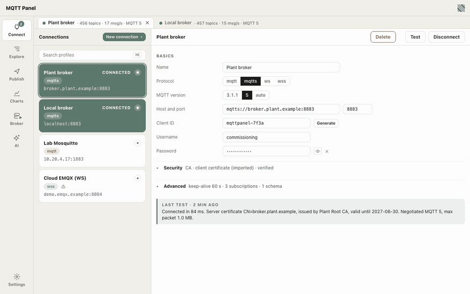

# MQTT Panel

See what is happening on your MQTT brokers: topics, values, history, charts, publishing, and a broker built in. A desktop app for macOS and Windows (Linux: build it yourself), with a command line and an MCP server for AI assistants.



[Watch the same clip as MP4](docs/media/readme-demo.mp4) (H.264, 15 s).

## Get it

- [Mac App Store](#) · coming soon
- [Microsoft Store](#) · coming soon
- [Download for macOS (.dmg)](https://github.com/linkineo/mqtt-panel/releases/latest/download/MQTT-Panel-macOS.dmg) · universal (Apple silicon and Intel), macOS 11 or later, signed and notarized, updates itself
- Source code, release notes and issues: [github.com/linkineo/mqtt-panel](https://github.com/linkineo/mqtt-panel)

MQTT Panel is installed and updated through the Mac App Store and the Microsoft Store. On macOS the same app is also available as a direct download from the [Releases](https://github.com/linkineo/mqtt-panel/releases) page; the direct download updates itself through the app: once a day at most it asks mqtt-panel.com whether a newer version exists (version, system and processor type only; switch it off in Settings, Updates) and installs it when you ask ([docs/UPDATER.md](docs/UPDATER.md)). Linux users and developers build it themselves (see below). Website: [mqtt-panel.com](https://mqtt-panel.com).

## Features

**Explorer**
- Topic tree with child counts, inline values, sparklines, new-message highlights and message counts; nodes stay collapsed until you open them.
- Flat table view, sortable by any column; search with substring, `+` and `#` wildcards or a regular expression; pinned topics and saved views.
- Payloads as JSON, text, hex, base64 or images; Sparkplug B, CBOR, MessagePack and Protobuf (with your own `.proto` files) decoded.
- Per-topic history, diff against the previous or any earlier message, MQTT 5 properties, delete retained messages.
- Several connections open at once, each with a tab and its live figures in the connection bar.

**Charts**
- Chart any numeric field of any payload as it arrives: a topic chart under the payload and a dashboard with several series.
- Two axes when the units differ, one time range for every chart, pause, export as CSV or PNG. History stays in memory.

**Publish**
- A composer with QoS, retain, delete retained and MQTT 5 properties; templates when you save one.
- A sent log with broker acknowledgements and re-send; repeat every n seconds to simulate a sensor; MQTT 5 request and response.
- Quick publish to the selected topic right in the Explorer.

**Built-in broker**
- An MQTT broker in the same window: TCP, TLS, WebSocket and secure WebSocket listeners, users and passwords, client certificates.
- Guided setups, a local CA, client certificates issued per device, live clients, counters and log. Every change applies at once.
- One menu entry connects the app to its own broker, with the user, certificate and trust it needs.

**Security**
- mqtt, mqtts, ws and wss; MQTT 3.1.1 and 5. Your own CA, client certificates (import, or generate a key and a signing request), self-signed brokers trusted by fingerprint.
- Passwords, private keys and passphrases stored encrypted, with the key in the system's secret store; never in profile files.

**Command line**
- `mqttpanel sub`, `pub`, `broker` and `profiles` use the same profiles and secrets as the app, with text, JSON, NDJSON or raw output.

**AI assistant through MCP (beta)**
- Beta: the tools and their texts may still change; tell us what you need.
- MQTT Panel is an MCP server: Claude and ChatGPT can set up connections and certificates, configure the built-in broker, build charts and export data, all through the running app.
- Every change shows in the window and in the Assistant log; no tool ever returns a password or a key. One button in Settings, Assistant adds MQTT Panel to Claude or to the ChatGPT desktop app. Details in [docs/MCP.md](docs/MCP.md).

The interface is in English, French and German.

## Build and run

Built with Tauri 2, a Rust engine and a React interface. No Docker, broker or account is needed.

### Prerequisites

| Platform | Install |
|---|---|
| macOS | Xcode command line tools (`xcode-select --install`), [Rust](https://rustup.rs) 1.88 or newer, [Node.js](https://nodejs.org) LTS (20 or newer) |
| Windows | Rust with the MSVC toolchain (`rustup default stable-x86_64-pc-windows-msvc`), Visual Studio Build Tools with the C++ workload, Node.js LTS, WebView2 (part of Windows 11 and updated Windows 10) |
| Linux | Rust, Node.js LTS and the Tauri 2 system packages below |

Debian or Ubuntu:

```
sudo apt update
sudo apt install libwebkit2gtk-4.1-dev build-essential curl wget file libxdo-dev \
  libssl-dev libayatana-appindicator3-dev librsvg2-dev
```

Fedora:

```
sudo dnf check-update
sudo dnf install webkit2gtk4.1-devel openssl-devel curl wget file libappindicator-gtk3-devel \
  librsvg2-devel libxdo-devel
sudo dnf group install "c-development"
```

For `cargo tauri`, install the Tauri CLI once: `cargo install tauri-cli --version "^2"` (the npm workspace also provides `npm run tauri`).

### Run and build

Get the source and work from the repository root:

```
git clone https://github.com/linkineo/mqtt-panel.git
cd mqtt-panel
npm ci                    # UI workspace; cargo fetches the Rust crates on the first build
npm run tauri dev         # development mode: live UI reload, Rust rebuilds on change
npm run dev               # the UI alone in a browser with a mock engine, http://localhost:1420
```

Release build:

```
cd apps/desktop/src-tauri
cargo tauri build
```

The bundle lands under `target/release/bundle/` at the repository root: `macos/MQTT Panel.app` and a `.dmg` on macOS, `appimage/`, `deb/` and `rpm/` on Linux. On Windows build the executable with `npm run tauri -- build --no-bundle`; the Microsoft Store package (MSIX) is made by `scripts/build-msix.ps1` as described in [docs/WINDOWS_BUILD.md](docs/WINDOWS_BUILD.md). Developer builds are not signed.

### Tests

```
cargo test --workspace            # Rust crates
npm test                          # Vitest, UI components
npm run e2e                       # Playwright flows and the overflow check in EN, FR and DE
cargo deny check                  # licences and advisories
```

Playwright needs its browser once: `npx --workspace @mqttpanel/ui playwright install chromium`.

### Command line

```
cargo build --release -p mqttpanel-cli
./target/release/mqttpanel --help
./target/release/mqttpanel sub -h localhost -p 1883 -t "#"
./target/release/mqttpanel pub -h localhost -p 1883 -t demo/hello -m 'hi'
./target/release/mqttpanel broker --bind 127.0.0.1
./target/release/mqttpanel profiles list
```

### AI assistant (beta)

An assistant app starts `mqttpanel mcp` (or the app's own executable with the argument `mcp`), which talks to the running app and starts it when needed. Settings, Assistant in the app writes the configuration for Claude and the ChatGPT desktop app; the manual setup is in [docs/RUNNING.md](docs/RUNNING.md), section 10.

More detail (data folder, environment variables, first steps, the Mac App Store build): [docs/RUNNING.md](docs/RUNNING.md).

## Documentation

| File | What it is for |
|---|---|
| [docs/SPEC.md](docs/SPEC.md) | Technical specification: architecture, data model, security, built-in broker, CLI, libraries, quality and release |
| [docs/FEATURES.md](docs/FEATURES.md) | Feature scope table and functional requirements |
| [docs/DECISIONS.md](docs/DECISIONS.md) | Decisions in force and readings awaiting the owner |
| [docs/TESTPLAN.md](docs/TESTPLAN.md) | Test plan |
| [docs/PROGRESS.md](docs/PROGRESS.md) | Implementation status of each feature and test results |
| [docs/RUNNING.md](docs/RUNNING.md) | Building and starting the app, the UI alone and the CLI; data folder; assistant setup by hand |
| [docs/MCP.md](docs/MCP.md) | The MCP interface for AI assistants: transport, security model, tools |
| [docs/WINDOWS_BUILD.md](docs/WINDOWS_BUILD.md) | Building and checking the Microsoft Store package on Windows |
| [docs/mockups/README.md](docs/mockups/README.md) | The validated HTML mockups that the interface must match |
| [HANDOFF.md](HANDOFF.md) | How to pick the project up |

## Licence

MQTT Panel is source-available under the Apache License 2.0 with the Commons Clause License Condition v1.0.
You may use it for free, at home or at work, including for your own commercial activities, change it and build it yourself. You may not sell MQTT Panel, nor sell a product or service whose value comes substantially from it.
See [LICENSE](LICENSE) and [NOTICE](NOTICE); the text in `LICENSE` is what applies.

## Privacy

Nothing leaves your computer except the traffic to the brokers you configure: no telemetry, no crash reports, no account.
